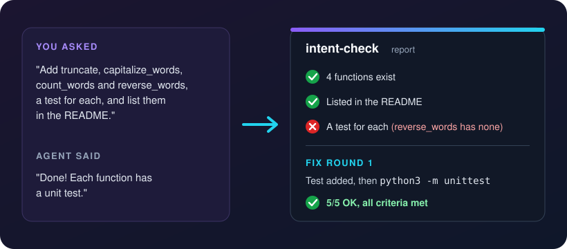
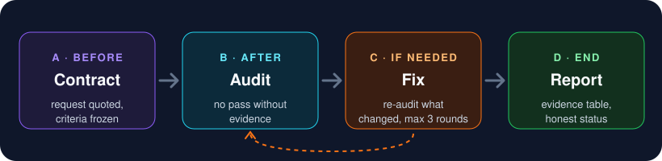

<p align="center">
  
</p>

<h1 align="center">intent-check</h1>
<p align="center"><b>A Claude Code skill that checks finished AI work against your original request, with evidence, and fixes what doesn't match.</b></p>

<p align="center">
  
  
</p>
<p align="center">
  
  
  
  
</p>

<p align="center">
  <a href="#-install">Install</a> ·
  <a href="#-use">Use</a> ·
  <a href="#️-how-it-works">How it works</a> ·
  <a href="#-eval-results">Evals</a> ·
  <a href="README.tr.md">Türkçe</a>
</p>

An agent says "Done!" and it usually is, mostly. intent-check answers one question before you believe it: **does what was done match what was asked?** It quotes your request word for word, turns it into criteria, collects evidence for each one (files, diffs, real test output), fixes what fails, and hands you a short table you can check line by line.

> Türkçe açıklama: [README.tr.md](README.tr.md)

## ✨ What it does

- 📜 **Contract first:** before work starts, your request is quoted verbatim and split into explicit, implicit and assumed criteria. The contract is frozen once written.
- 🔍 **Evidence, not vibes:** no ✅ without a file and line, a diff hunk, a command plus its real output, or a screenshot. Anything it can't verify is ❓.
- 🛠️ **Fixes what fails:** ❌ and ⚠️ items are fixed and re-audited, for at most 3 rounds. Then it stops and tells you what is still open.
- 🧭 **Catches side effects:** "nothing else broke" is a criterion too, so a shared constant that silently moved is caught.
- 🚧 **Flags scope creep:** changes you didn't ask for are listed in the report.
- 🔁 **Handles changed requests:** if you change your mind mid-task, a new contract version is written and the old one is kept.
- 🔒 **Local and read-only:** pure Markdown instructions, no code, no network calls, no telemetry.

## 📦 Install

Clone it into your Claude Code skills directory:

```bash
# for you (all projects)
git clone https://github.com/shadow-lo/intent-check ~/.claude/skills/intent-check

# or for one project (commit it so your team gets it)
git clone https://github.com/shadow-lo/intent-check .claude/skills/intent-check
```

That's it. Claude Code picks it up on the next session. Only `SKILL.md` and `references/` are used at runtime; the rest is docs and evals.

## 🚀 Use

| Mode | When |
| --- | --- |
| **Automatic** | A request with two or more requirements, something vague ("make it nicer"), or a change that touches tested or shared code. The skill writes a contract before work starts and audits at the end. |
| **Manual** | Type `/intent-check` or "did you do what I asked?". It finds your first request in the conversation and audits against it. |
| **Not triggered** | Questions, chat, or trivial edits such as typo fixes. |

<details>
<summary><b>📋 Example report</b></summary>

```markdown
## intent-check report

**Request:** "Change the member discount from 10% to 15%."

| # | Criterion | Type | Result | Evidence |
|---|---|---|---|---|
| 1 | Member discount is 15% | Explicit | ✅ | `member_price(100)` → 85.0 |
| 2 | Free shipping still starts at 550 | Implicit | ❌ → ✅ | Round 1: shared RATE moved it to 575; split into two constants |
| 3 | Existing tests pass | Implicit | ❌ → ✅ | `python3 -m unittest` → 2/2 OK |

**Assumptions:** You only wanted the discount to change, not the shipping threshold.
**Decisions needed from you:** None
**Scope creep:** None
**Fix rounds:** 1
**Auditor:** self, no subagent tool
**Status:** All criteria met.
```

</details>

More before/after cases in [`examples/`](examples/).

## ⚙️ How it works

<p align="center">
  
</p>

| Phase | When | What |
|---|---|---|
| **A. Contract** | Before work | Quotes your request word for word, splits it into explicit / implicit / assumption criteria, each with a way to verify it. Frozen once written. |
| **B. Audit** | After work | Collects evidence per criterion (files, diffs, test runs, screenshots). **No ✅ without evidence**; unverifiable = ❓. Lists scope creep. Uses an independent subagent that never saw the work conversation, when available. |
| **C. Fix** | If something fails | Fixes ❌ / ⚠️ items and re-audits only what could be affected. **Max 3 rounds**, then stops and says what is still open. |
| **D. Report** | End | Short table: criterion, result, evidence, plus assumptions, decisions needed, scope creep, round count. |

## 📊 Eval results

8 scenarios, each run with and without the skill (Claude Sonnet, one run each). Full details and raw outputs: [`evals/RESULTS.md`](evals/RESULTS.md).

| Metric | Without skill | With skill |
|---|---|---|
| Seeded defects caught | 5 / 5 | 5 / 5 |
| False alarms on correct work | 0 / 1 | 0 / 1 |
| Triggered on a one-line typo fix | n/a | 0 / 1 |
| Reply is an evidence table with the verbatim request | 0 / 7 | 7 / 7 (3 / 7 before a fix in round 3) |

> [!NOTE]
> Honestly: when the baseline agent was explicitly invited to check its work, it caught the same defects. The skill's measured value here is a checkable, evidence-backed report, contract versioning when the request changes, and reliable triggering. The evals also found real weaknesses (two missed triggers, replies in prose instead of the report), which were fixed and re-tested. See RESULTS.md for what the evals do **not** show.

## 🔒 Security and privacy

- No code, no network calls, no telemetry, no dependencies: it is Markdown instructions.
- The skill tells the agent never to send repository content, contracts or reports to external services, never to copy secrets into reports (`[REDACTED]`), and to keep the audit read-only.
- Contracts go to a private temp directory by default. If you opt into `.intent-check/` in your project, add it to `.gitignore`.

Details: [SECURITY.md](SECURITY.md).

## ⚠️ Limitations

- **Same model, same blind spots.** Even with a fresh subagent, the auditor is usually the same model as the worker and can share its misunderstandings.
- **Evidence is only as good as your tests.** If a behaviour has no test and can't be run, it ends up ❓, not ✅.
- **UI checks** need a browser or screenshot tool; without one they are ❓ or based on reading markup.
- **Small evals.** 8 tiny scenarios, one run each. Treat the numbers as a smoke test, not a benchmark.
- Instructions are not a sandbox: your agent's own permission settings are the real safety layer.

## 🗂️ Layout

```text
SKILL.md          the skill (frontmatter + 4 phases)
references/       contract, verification, auditor and report templates
examples/         4 before/after cases from the evals
evals/            scenarios, builder script, results, raw outputs
docs/img/         README images
SECURITY.md       security and privacy notes
LICENSE           MIT
```

## 📄 License

[MIT](LICENSE)
