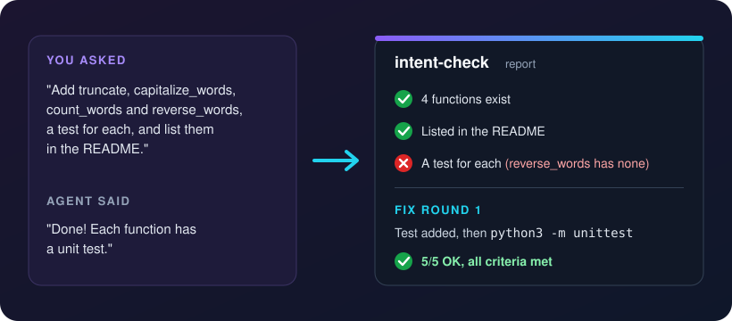
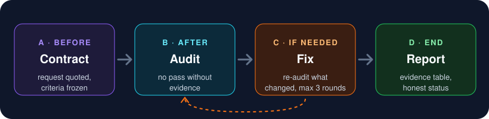

<p align="center">
  
</p>

<h1 align="center">intent-check</h1>
<p align="center"><b>Yapay zekânın bitirdiği işi, senin ilk isteğine karşı kanıtla denetleyen ve tutmayan yerleri düzelttiren bir Claude Code skill'i.</b></p>

<p align="center">
  
  
</p>
<p align="center">
  
  
  
  
</p>

<p align="center">
  <a href="#-kurulum">Kurulum</a> ·
  <a href="#-kullanım">Kullanım</a> ·
  <a href="#️-nasıl-çalışır">Nasıl çalışır</a> ·
  <a href="#-test-sonuçları">Testler</a> ·
  <a href="README.md">English</a>
</p>

Ajan "Bitti!" der ve genelde büyük ölçüde bitmiştir. intent-check, buna inanmadan önce tek bir soruyu yanıtlar: **Yapılan iş, istenenle örtüşüyor mu?** İsteğini kelimesi kelimesine alıntılar, kriterlere böler, her biri için kanıt toplar (dosya, diff, gerçek test çıktısı), tutmayanı düzeltir ve satır satır kontrol edebileceğin kısa bir tablo verir.

> English: [README.md](README.md)

## ✨ Ne yapar

- 📜 **Önce sözleşme:** İş başlamadan isteğin birebir alıntılanır; açık, örtük ve varsayım kriterlerine bölünür. Sözleşme yazıldıktan sonra değişmez.
- 🔍 **Tahmin değil kanıt:** Dosya ve satır, diff parçası, komut ve gerçek çıktısı ya da ekran görüntüsü olmadan ✅ yok. Doğrulanamayan her şey ❓ olur.
- 🛠️ **Tutmayanı düzeltir:** ❌ ve ⚠️ maddeler düzeltilip yeniden denetlenir, en fazla 3 tur. Sonra durur ve açık kalanları söyler.
- 🧭 **Yan etkileri yakalar:** "Başka bir şey bozulmadı" da bir kriterdir; sessizce değişen ortak bir sabit yakalanır.
- 🚧 **Kapsam taşmasını gösterir:** İstemediğin değişiklikler raporda listelenir.
- 🔁 **Değişen isteği yönetir:** İş ortasında fikrini değiştirirsen yeni bir sözleşme sürümü yazılır, eskisi korunur.
- 🔒 **Yerel ve salt okunur:** Yalnızca Markdown talimatları; kod, ağ çağrısı, telemetri yok.

## 📦 Kurulum

Claude Code skill klasörüne klonla:

```bash
# kendin için (tüm projelerde)
git clone https://github.com/shadow-lo/intent-check ~/.claude/skills/intent-check

# ya da tek bir proje için (commit'lersen ekibin de kullanır)
git clone https://github.com/shadow-lo/intent-check .claude/skills/intent-check
```

Bu kadar. Claude Code bir sonraki oturumda skill'i görür. Çalışırken yalnızca `SKILL.md` ve `references/` kullanılır; geri kalanı belge ve testtir.

## 🚀 Kullanım

| Mod | Ne zaman |
| --- | --- |
| **Otomatik** | İki veya daha fazla gereksinim içeren, belirsiz ("daha güzel yap") ya da testli veya ortak kullanılan koda dokunan bir iş. Skill iş başlamadan bir sözleşme yazar, sonunda denetler. |
| **Elle** | `/intent-check` yaz ya da "istediğimi yaptı mı kontrol et" de. Konuşmadaki ilk isteğini bulur ve ona göre denetler. |
| **Tetiklenmez** | Sorular, sohbet ve yazım hatası düzeltmesi gibi basit işler. |

<details>
<summary><b>📋 Örnek rapor</b></summary>

```markdown
## intent-check raporu

**İstek:** "Üye indirimini %10'dan %15'e çıkar."

| # | Kriter | Tür | Sonuç | Kanıt |
|---|---|---|---|---|
| 1 | Üye indirimi %15 | Açık | ✅ | `member_price(100)` → 85.0 |
| 2 | Ücretsiz kargo hâlâ 550'den başlıyor | Örtük | ❌ → ✅ | 1. tur: ortak RATE bunu 575'e kaydırmıştı; iki sabite ayrıldı |
| 3 | Mevcut testler geçiyor | Örtük | ❌ → ✅ | `python3 -m unittest` → 2/2 OK |

**Varsayımlar:** Yalnızca indirimin değişmesini istediğin, kargo eşiğinin değil.
**Karar vermen gerekenler:** Yok
**Kapsam taşması:** Yok
**Düzeltme turu:** 1
**Denetçi:** kendisi, alt ajan aracı yok
**Durum:** Tüm kriterler karşılandı.
```

</details>

Daha fazla önce/sonra vakası: [`examples/`](examples/).

## ⚙️ Nasıl çalışır

<p align="center">
  
</p>

| Faz | Ne zaman | Ne yapar |
|---|---|---|
| **A. Sözleşme** | İş başlamadan | İsteğini kelimesi kelimesine alıntılar; açık, örtük ve varsayım kriterlerine böler, her birine doğrulama yöntemi yazar. Yazıldıktan sonra değişmez. |
| **B. Denetim** | İş bittikten sonra | Her kriter için kanıt toplar (dosya, diff, test çıktısı, ekran görüntüsü). **Kanıtsız ✅ yok**; doğrulanamayan ❓ olur. Kapsam taşmalarını listeler. Varsa, iş konuşmasını hiç görmemiş bağımsız bir alt ajan denetler. |
| **C. Düzeltme** | Hata çıkarsa | ❌ / ⚠️ maddeleri düzeltir, yalnızca etkilenebilecek maddeleri yeniden denetler. **En fazla 3 tur**, sonra durur ve açık kalanları söyler. |
| **D. Rapor** | Sonda | Kısa tablo: kriter, sonuç, kanıt; ayrıca varsayımlar, karar gerekenler, kapsam taşması, tur sayısı. |

## 📊 Test sonuçları

8 senaryo, her biri skill'li ve skill'siz çalıştırıldı (Claude Sonnet, her biri bir kez). Ayrıntılar ve ham çıktılar: [`evals/RESULTS.md`](evals/RESULTS.md).

| Ölçüt | Skill'siz | Skill'li |
|---|---|---|
| Yerleştirilen hataları yakalama | 5 / 5 | 5 / 5 |
| Doğru işe yanlış alarm | 0 / 1 | 0 / 1 |
| Tek satırlık yazım düzeltmesinde tetiklenme | yok | 0 / 1 |
| Yanıt, birebir alıntılanmış istekle kanıt tablosu | 0 / 7 | 7 / 7 (3. turdaki düzeltmeden önce 3 / 7) |

> [!NOTE]
> Dürüst olmak gerekirse: Skill'siz ajana işini kontrol etmesi açıkça söylendiğinde aynı hataları o da yakaladı. Bu testlerde skill'in ölçülen katkısı; satır satır doğrulanabilen kanıtlı rapor, istek değişince sözleşmenin sürümlenmesi ve doğru tetiklenme oldu. Testler gerçek zayıflıklar da buldu (iki kaçan tetiklenme, rapor yerine düz yazı yanıt); bunlar düzeltilip yeniden test edildi. Testlerin neyi **göstermediği** RESULTS.md'de yazıyor.

## 🔒 Güvenlik ve gizlilik

- Kod yok, ağ çağrısı yok, telemetri yok, bağımlılık yok: yalnızca Markdown talimatları.
- Skill ajana şunları söyler: Repo içeriğini, sözleşmeyi veya raporu hiçbir dış servise gönderme; sırları rapora kopyalama (`[REDACTED]` yaz); denetimi salt okunur yap.
- Sözleşmeler varsayılan olarak yalnızca senin erişebildiğin geçici bir klasöre yazılır. Projede `.intent-check/` kullanmayı seçersen onu `.gitignore`'a ekle.

Ayrıntılar: [SECURITY.md](SECURITY.md).

## ⚠️ Sınırlamalar

- **Aynı model, aynı kör noktalar.** Bağımsız alt ajan kullanılsa bile denetçi genelde işi yapanla aynı modeldir ve aynı yanlış anlamayı paylaşabilir.
- **Kanıt, testlerin kadar iyidir.** Testi olmayan ve çalıştırılamayan bir davranış ❓ olur, ✅ olmaz.
- **Arayüz kontrolleri** tarayıcı veya ekran görüntüsü aracı ister; yoksa ❓ olur ya da yalnızca kod okunarak değerlendirilir.
- **Küçük testler.** 8 küçük senaryo, her biri bir kez çalıştı. Sayıları kapsamlı bir ölçüm değil, ön kontrol olarak düşün.
- Talimatlar bir korumalı alan (sandbox) değildir: Asıl güvenlik katmanı ajanının kendi izin ayarlarıdır.

## 🗂️ Klasör yapısı

```text
SKILL.md          skill'in kendisi (frontmatter + 4 faz)
references/       sözleşme, doğrulama, denetçi ve rapor şablonları
examples/         testlerden 4 önce/sonra vakası
evals/            senaryolar, kurulum betiği, sonuçlar, ham çıktılar
docs/img/         README görselleri
SECURITY.md       güvenlik ve gizlilik notları
LICENSE           MIT
```

## 📄 Lisans

[MIT](LICENSE)
